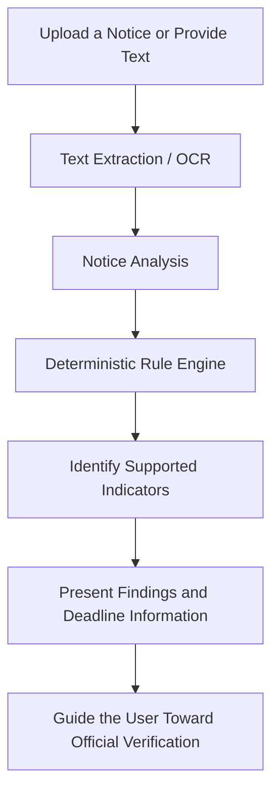
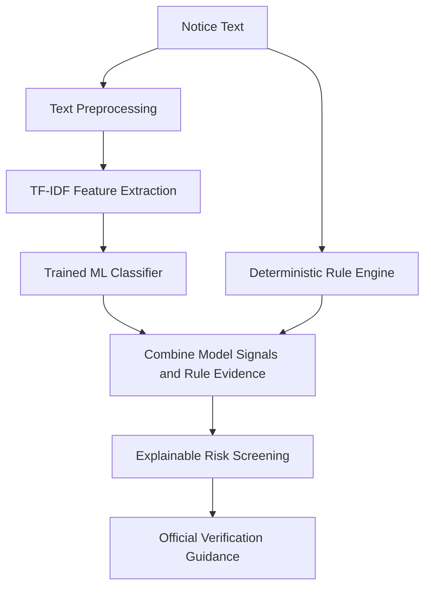

# Lexora
### Understand the Notice. Identify the Risk. Verify with Confidence.

**Lexora is a document-understanding and risk-screening platform designed to help people interpret Indian government, tax, legal, and business notices, identify suspicious indicators, recognize important deadlines, and understand how to verify information through official channels.**

> **Our vision:** Make complex notices easier to understand and suspicious indicators easier to investigate.

## 🚨 The Problem

Important notices can be difficult to interpret. People may struggle to understand legal language, identify deadlines, spot inconsistencies, or distinguish suspicious communications from legitimate ones. A missed deadline or an unverified payment request can have serious consequences.

Traditional document readers extract text—but understanding what deserves attention requires more.

## 💡 The Solution

Lexora transforms notice text into actionable, understandable information.

- 📄 **Document Extraction:** Extract text from supported documents, with OCR support through Tesseract.
- 🔍 **Notice Analysis:** Apply deterministic rules to identify supported notice patterns and potential warning signs.
- 📅 **Deadline Awareness:** Help identify relevant dates and deadlines where supported.
- ⚠️ **Risk Indicators:** Highlight findings that may require further investigation.
- 🧾 **Evidence-Based Results:** Connect findings to identifiable document details wherever supported.
- 🏛️ **Verification Guidance:** Help users understand the importance of checking consequential notices through appropriate official channels.

*Lexora is a screening assistant, not a definitive fraud detector or an authority on document authenticity.*

## ⚙️ How It Works

The current system uses predefined analysis rules. OCR extracts text; it does not independently establish whether a notice is fraudulent.

## 🧠 Technology Stack

| Technology | Purpose |
|---|---|
| Next.js | Web application |
| TypeScript / JavaScript | Application development |
| Node.js | Backend runtime |
| Tesseract.js | OCR-based text extraction |
| REST API | Communication between application components |
| Automated tests | Check application behavior and reliability |
| Synthetic sample notices | Demonstration and development testing |

*Confirm individual technologies against the repository before treating this table as a complete inventory.*

## 🤖 Future Innovation: Hybrid Rules + Machine Learning

**Planned extension — not yet implemented as a trained ML classifier.**

Lexora aims to evolve beyond manually defined rules by exploring a hybrid system that combines transparent checks with machine learning.

### Proposed ML Pipeline

**Proposed baseline:**
- **TF-IDF:** Converts text into numerical features that represent the importance of words and phrases.
- **Logistic Regression:** A supervised machine-learning model that can learn patterns from labelled examples of suspicious and legitimate notices.
- **Hybrid Analysis:** Combines model signals with explicit rule-based findings.
- **Performance Evaluation:** Uses precision, recall, F1 score, and false-positive/false-negative analysis to evaluate the model.

This approach requires a suitable labelled dataset, training, independent testing, and validation before it can be considered reliable. Machine-learning predictions would indicate potential risk—not prove fraud or authenticity.

## 🛡️ Responsible by Design

Lexora is being developed with an emphasis on explainability and responsible use.

- **Evidence over unsupported claims:** Findings should be connected to observable document information.
- **Clear uncertainty:** Suspicious indicators are not proof of fraud.
- **Privacy awareness:** Sensitive documents require careful handling and appropriate safeguards.
- **Official verification:** Consequential notices should be checked through trusted official channels.
- **Honest evaluation:** Synthetic test results must not be represented as real-world fraud-detection accuracy.

A synthetic registry or demonstration dataset is not a live government database.

## 🚀 Roadmap

- **Improve:** Strengthen extraction, rule coverage, deadline interpretation, and error handling.
- **Explain:** Make findings easier to understand and trace to supporting evidence.
- **Experiment:** Build and evaluate a genuine ML classification baseline using appropriately labelled data.
- **Integrate:** Explore a validated hybrid rules-plus-ML screening workflow.
- **Verify:** Improve guidance toward appropriate official verification channels.
- **Harden:** Strengthen security, privacy, testing, and deployment readiness.

These are development goals, not claims that the features are already available.

## 🎯 Potential Impact

Lexora aims to make complex notices more accessible to individuals and small businesses by helping them understand important information, recognize potential warning signs, and identify appropriate next steps.

The long-term goal is to support **better-informed decisions through understandable evidence and responsible risk screening.**

## ⚠️ Limitations

Lexora cannot guarantee that a notice is genuine or fraudulent. OCR can misread text, deterministic rules cover only known conditions, and any future ML model may produce incorrect results. Detection quality must be established through appropriate testing on representative data.

Users should verify consequential notices independently through official sources and seek qualified professional advice when necessary.

## 📌 Project Status

| Component | Status |
|---|---|
| Backend API and rule-based analysis | Implemented; see repository tests and limitations |
| Text extraction and OCR | Implemented; accuracy depends on document quality |
| Automated tests and synthetic benchmarks | Available for development evaluation |
| Similarity analysis | Experimental, where available |
| Synthetic registry comparison | Demonstration only, where available |
| Trained ML fraud-risk classifier | Planned |
| Live government registry integration | Not established |
| Production readiness | Requires further validation |

## 🌱 Our Direction

**Lexora is building toward a more understandable and evidence-centred way to review important notices.** By combining document extraction, transparent analysis, and a future validated machine-learning component, the project aims to help people identify what deserves attention—and what they should verify next.
